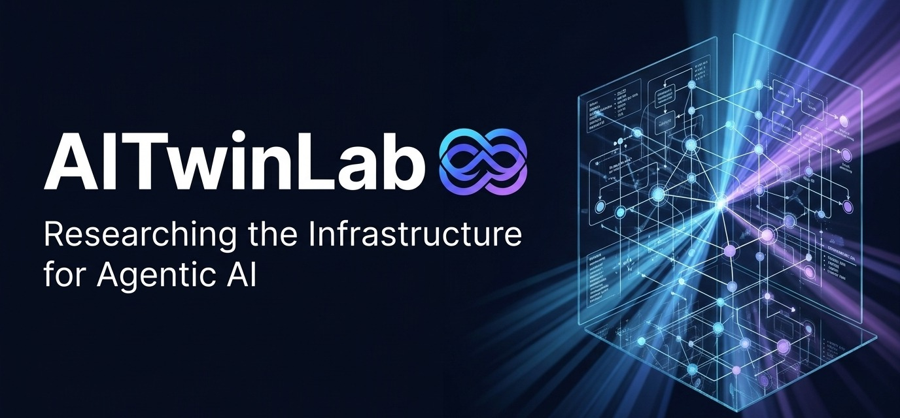

 

**AITwinLab** is an independent research lab based in Da Nang, Vietnam, dedicated to building and investigating the fundamental infrastructure, runtime harnesses, and formal guarantees needed for autonomous, trustworthy AI agents.

---

## 🔬 Core Research Directions

Our research investigates the gap between foundation models and production deployment in real-world environments:

### 1. The Agent Harness (`Agent = Model + Harness`)
A raw foundation model is only as effective as the runtime enclosing it. We research execution environments, sandboxing, structured memory tiers, and context management protocols.

### 2. Workflow Orchestration (BPMN / DMN for Agents)
Complex business logic cannot rely on unconstrained LLM loops. We integrate standard business process modeling (BPMN) and decision tables (DMN) with probabilistic agent planning.

### 3. Trustworthy AI & Provable Correctness
Methods for verifying agent trajectory correctness, policy boundaries, security constraints, and safety properties before execution.

### 4. Digital Twins & Human–AI Symbiosis
Modeling physical and cyber environments as digital twins where multi-agent collectives simulate, test, and safely optimize operations.

---

## 📚 Student & Academic Research Programs

In collaboration with the **Vietnam-Korea University of ICT (VKU)**, AITwinLab supports undergraduate and graduate researchers through:
- Open-source benchmark suites for AI agents.
- Applied research topics in computer vision, robotics, and cross-platform agent systems.
- Code artifacts, reproduction packages, and technical papers.

---

## 🌐 Official Channels & Connect

| Channel | Link | Handle / Note |
|---|---|---|
| 🌐 **Website** | [aitwinlab.org](https://aitwinlab.org) | Research portal & publications |
| 💼 **LinkedIn** | [linkedin.com/company/aitwinlab](https://linkedin.com/company/aitwinlab) | Professional updates & research highlights |
| 🐦 **X (Twitter)** | [x.com/aitwinlab](https://x.com/aitwinlab) | `@aitwinlab` — Announcements & papers |
| 📘 **Facebook** | [facebook.com/aitwinlab](https://facebook.com/aitwinlab) | Community & student workshops |
| 📺 **YouTube** | [youtube.com/@aitwinlab](https://youtube.com/@aitwinlab) | Talks, seminars & demo sessions |
| ✉️ **Email** | [contact@tuannguyen.dev](mailto:contact@tuannguyen.dev) | Research collaborations |

---

  © 2026 AITwinLab. Principal Investigator: <a href="https://tuannguyen.dev">Nguyen Thanh Tuan, PhD</a>. Released under the MIT License.

